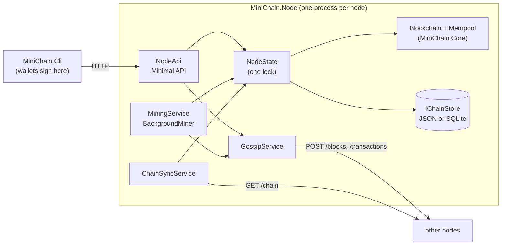

# MiniChain

[](https://github.com/<your-user>/minichain/actions/workflows/ci.yml)

An educational blockchain built from scratch in C# on .NET 10: blocks linked by SHA-256 hashes,
proof-of-work mining, transactions signed with ECDSA, and a network of HTTP nodes that agree on a
single chain.

> ⚠️ **Educational project.** MiniChain is not secure enough for real money. Do not use it to store
> or move anything of value.

The step-by-step plan this repository follows is in [docs/MiniChain-Action-Plan.md](docs/MiniChain-Action-Plan.md),
with every "Done when" box ticked as it was completed. Each phase is one or more commits, so
`git log --reverse --oneline` walks through the project in the same order as the plan.

- [What is inside](#what-is-inside)
- [Architecture](#architecture)
- [Quick start](#quick-start)
- [Run one node](#run-one-node)
- [Run three nodes](#run-three-nodes)
- [Run a network with Docker](#run-a-network-with-docker)
- [HTTP API](#http-api)
- [Configuration](#configuration)
- [Persistence](#persistence)
- [Mining benchmark](#mining-benchmark)
- [Design decisions](#design-decisions)
- [Known limitations](#known-limitations)
- [Tests](#tests)
- [Repository layout](#repository-layout)

## What is inside

| Phase | Feature | Main types |
|---|---|---|
| 2 | SHA-256 hashing and a canonical, culture-independent block header | `HashUtil`, `Block` |
| 3 | A chain that starts from a hard-coded genesis block | `Blockchain`, `Genesis` |
| 4 | Tamper detection | `ChainValidator` |
| 5 | Proof of work: naive, optimized and parallel miners; optional difficulty retargeting | `Miner`, `ProofOfWork`, `DifficultyAdjustment` |
| 6 | Transactions, balances, mining rewards and a mempool | `Transaction`, `LedgerState`, `Mempool` |
| 7 | Wallets and ECDSA (NIST P-256) signatures | `Wallet`, `SignatureVerifier`, `Address` |
| 8 | HTTP nodes, gossip and most-work consensus | `MiniChain.Node` |
| 9 | Persistence in a JSON file or SQLite | `MiniChain.Node/Storage` |
| 10–11 | Unit and integration tests, analyzers, Docker, CI | `tests/`, `Dockerfile`, `.github/` |

## Architecture



- **MiniChain.Core** holds every blockchain rule: hashing, validation, mining, transactions, wallets
  and consensus. It knows nothing about HTTP or the console, so all of it is unit-tested directly.
- **MiniChain.Node** is a thin ASP.NET Core layer. `NodeState` is the only code that touches the
  (not thread-safe) `Blockchain` and `Mempool`, always under one lock, and never while mining, waiting
  on the network or validating a whole chain. Gossip and chain downloads run in background services.
- **MiniChain.Cli** runs the experiments of each phase on an in-memory chain, manages wallets, and
  talks to nodes. Transactions are signed in the CLI, so private keys never leave your machine.

## Quick start

You need the [.NET 10 SDK](https://dotnet.microsoft.com/download).

```bash
dotnet build
dotnet test
```

Each phase has an experiment that runs on its own in-memory chain:

```bash
dotnet run --project src/MiniChain.Cli -- demo          # mine a few blocks with signed payments
dotnet run --project src/MiniChain.Cli -- tamper        # rewrite history and watch validation catch it
dotnet run --project src/MiniChain.Cli -- ledger        # overspend, double spend, replay: all rejected
dotnet run --project src/MiniChain.Cli -- signatures    # forged or edited signatures: all rejected
dotnet run --project src/MiniChain.Cli -c Release -- bench   # the mining benchmark below
```

The examples below shorten `dotnet run --project src/MiniChain.Cli --` to `minichain`:

```bash
alias minichain='dotnet run --project src/MiniChain.Cli --'                  # bash
function minichain { dotnet run --project src/MiniChain.Cli -- @args }       # PowerShell
```

## Run one node

```bash
dotnet run --project src/MiniChain.Node --urls http://localhost:5001
```

The node logs where it keeps its chain and its own wallet (by default in
`src/MiniChain.Node/node-data/5001/`, which Git ignores). Then:

```bash
curl http://localhost:5001/                   # status: height, tip, difficulty, peers
curl -X POST http://localhost:5001/mine       # mine a block; the reward goes to the node's wallet
curl http://localhost:5001/chain              # the whole chain
```

Wallets and payments:

```bash
minichain wallet new --name alice             # creates wallets/alice.pem and prints the address
minichain wallet new --name bob
minichain mine --name alice                   # the node mines a block that pays Alice 50
minichain send --name alice --to <Bob's address> --amount 10 --fee 1
minichain mine --name bob                     # Bob mines Alice's payment and earns 50 + 1
minichain balance --name alice                # 39
```

`send` asks the node for Alice's next nonce, signs the transaction locally and submits it. Add
`--password` to `wallet new` to encrypt the key file (or set `MINICHAIN_WALLET_PASSWORD`).

## Run three nodes

Start each node in its own terminal:

```bash
dotnet run --project src/MiniChain.Node --urls http://localhost:5001
dotnet run --project src/MiniChain.Node --urls http://localhost:5002
dotnet run --project src/MiniChain.Node --urls http://localhost:5003
```

Connect them. Adding a peer is mutual: the new peer is told about this node, and both sync.

```bash
minichain peers add http://localhost:5002 --node http://localhost:5001
minichain peers add http://localhost:5003 --node http://localhost:5001
minichain peers add http://localhost:5003 --node http://localhost:5002
```

(With curl: `curl -X POST http://localhost:5001/peers -H "Content-Type: application/json" -d '{"url":"http://localhost:5002"}'`.)

**Experiment 1: a block travels.** Mine on one node and check another:

```bash
minichain mine --name alice --node http://localhost:5001
minichain status --node http://localhost:5003           # same height and tip
```

**Experiment 2: a network split.** Cut node 5003 off, let both sides mine, then reconnect:

```bash
minichain peers remove http://localhost:5001 --node http://localhost:5003
minichain peers remove http://localhost:5002 --node http://localhost:5003
minichain peers remove http://localhost:5003 --node http://localhost:5001
minichain peers remove http://localhost:5003 --node http://localhost:5002

minichain mine --node http://localhost:5003             # twice on the small side
minichain mine --node http://localhost:5003
minichain mine --node http://localhost:5001             # four times on the big side
minichain mine --node http://localhost:5001
minichain mine --node http://localhost:5001
minichain mine --node http://localhost:5001

minichain peers add http://localhost:5001 --node http://localhost:5003
minichain status --node http://localhost:5003           # now on the longer chain
```

Node 5003 logs `Replaced our chain with http://localhost:5001's: height ... -> ...`. Transactions
that only existed in its discarded blocks go back to its mempool and are gossiped again.

**Experiment 3: an invalid block.** Send a block with a made-up hash straight to a node:

```bash
curl -X POST http://localhost:5001/blocks -H "Content-Type: application/json" \
  -d '{"index":99,"timestamp":1,"previousHash":"aa","transactions":[],"difficulty":4,"nonce":0,"hash":"0000abc"}'
# 400 {"error":"Block #99: the stored hash 0000abc does not match the block's contents (...)"}
```

## Run a network with Docker

```bash
docker compose up --build
```

starts three nodes on ports 5001, 5002 and 5003 that already know each other (inside the compose
network they are `http://node1:8080` and so on). Use the CLI or curl against them exactly as above.
Each node keeps its chain and wallet in its own volume; `docker compose down -v` wipes them.

The image is built by the multi-stage [Dockerfile](Dockerfile). Without it,
`dotnet publish src/MiniChain.Node -c Release /t:PublishContainer` builds an image too.

## HTTP API

| Method | Route | Purpose | Answers |
|---|---|---|---|
| `GET` | `/` | Node status: URL, height, latest hash, next difficulty, cumulative work, pending count, peers, miner address | 200 |
| `GET` | `/chain` | The full chain: `{ length, cumulativeWork, blocks }` | 200 |
| `GET` | `/chain/latest` | The latest block | 200 |
| `GET` | `/balance/{address}` | `{ address, balance, nonce, nextNonce }`; `nextNonce` counts pending transactions | 200; 400 for a bad address |
| `POST` | `/transactions` | Submit a signed transaction | 202 accepted; 409 already known; 400 invalid, with the reason |
| `GET` | `/mempool` | Pending transactions | 200 |
| `POST` | `/mine?minerAddress=...` | Mine a block now; the reward goes to `minerAddress` or to the node's wallet | 200 with the block; 409 if other blocks kept arriving |
| `POST` | `/blocks` | Receive a block from a peer | 200 `appended`, `known` or `ignored`; 202 `syncing`; 400 invalid |
| `GET` | `/peers` | Known peers | 200 |
| `POST` | `/peers` | `{ "url": "http://..." }`: add a peer, introduce this node to it, and sync | 200; 400 for a bad URL or the node itself |
| `DELETE` | `/peers?url=...` | Remove a peer (used by the network-split experiment) | 204; 404 |

A transaction as JSON (amounts are whole numbers in the smallest unit):

```json
{
  "from": "5c1ed9199037284d06b791017ea5ffb066123df6",
  "to": "038ef8d797cb7bf3e69f0d174d83ea6772698345",
  "amount": 10,
  "fee": 1,
  "nonce": 1,
  "timestamp": 1793484354013,
  "publicKey": "3059301306072a8648ce3d0201...",
  "signature": "9d0f...",
  "id": "e092ca8da743c9bc52b4b5b8156d3cf16d8336e5fc8126eff71bcf89dda525ab"
}
```

Nodes add an `X-MiniChain-Peer` header with their own URL when they forward blocks and transactions,
so the receiver knows whom to download the chain from if it turns out to be behind.

## Configuration

Settings live in the `MiniChain` section of `appsettings.json` and can be overridden on the command
line (`--MiniChain:Difficulty 3`) or with environment variables (`MiniChain__Difficulty=3`).

| Setting | Default | Meaning |
|---|---|---|
| `PublicUrl` | the address the server listens on | The URL other nodes use to reach this one |
| `Peers` | none | Peers to connect to at startup (`MiniChain__Peers__0=...`) |
| `Difficulty` | 4 | Leading zero hex digits a block hash needs. Every node in a network must agree |
| `BlockReward` | 50 | New coins per block, on top of the fees |
| `MaxTransactionsPerBlock` | 100 | Transactions per block besides the coinbase |
| `AdjustDifficulty` | false | Retarget every 10 blocks towards 10 seconds per block |
| `MinerAddress` | the node's own wallet | Where mining rewards go |
| `AutoMine` | false | Keep mining while transactions are pending |
| `MiningThreads` | one per processor | Threads used by the parallel miner |
| `SyncIntervalSeconds` | 30 | How often to poll peers and catch up if one is ahead (0 = never) |
| `PeerTimeoutSeconds` | 5 | How long to wait for a peer |
| `Storage` | `json` | `json`, `sqlite` or `memory` |
| `DataDirectory` | `node-data/<port>` | Where the chain and the node's wallet are kept |

## Persistence

- **json** (the default) writes the whole chain to `chain.json` after every change, atomically (to a
  temporary file that is then swapped in). It is indented so you can read it.
- **sqlite** stores blocks and transactions in two tables in `chain.db` and only rewrites from the
  first block that changed.
- **memory** keeps nothing; the integration tests use it.

When a node starts it revalidates the stored chain from the genesis block. Try it: stop a node, change
an `"amount"` in its `chain.json`, and start it again. It refuses, with a message that names the broken block:

```
crit: MiniChain.Node[4]
      Cannot start: The chain stored in ...\chain.json is corrupted or was created with different settings:
      Block #1: the stored hash 0008... does not match the block's contents (computed bfca...).
```

If `MinerAddress` is not set, the node mines to a wallet of its own, `node-wallet.pem`, kept in the
same folder. To spend those rewards, point the CLI at that folder:
`minichain send --wallet-dir src/MiniChain.Node/node-data/5001 --name node-wallet --to ... --amount ...`.

## Mining benchmark

Run it yourself with `dotnet run --project src/MiniChain.Cli -c Release -- bench`.

Measured on an Intel Core i7-11800H laptop (8 cores, 16 threads), Windows 11, .NET 10, Release
build. Each row averages 3 blocks. Times are per block, and the hash rate is *hashes needed ÷ time*.
All three miners find the same nonce for the same block, so they do exactly the same work.

| Difficulty | Avg. hashes | Naive | Optimized | Parallel | Parallel vs. naive |
|---:|---:|---:|---:|---:|---:|
| 1 | 11 | 0.20 ms (58 kH/s) | 0.10 ms (112 kH/s) | 4.49 ms (3 kH/s) | 0.0x |
| 2 | 174 | 1.49 ms (117 kH/s) | 0.16 ms (1.06 MH/s) | 4.40 ms (40 kH/s) | 0.3x |
| 3 | 2,664 | 18.37 ms (145 kH/s) | 1.43 ms (1.86 MH/s) | 3.75 ms (711 kH/s) | 4.9x |
| 4 | 36,850 | 189.55 ms (194 kH/s) | 22.65 ms (1.63 MH/s) | 15.47 ms (2.38 MH/s) | 12.3x |
| 5 | 416,114 | 1.08 s (384 kH/s) | 170.50 ms (2.44 MH/s) | 27.95 ms (14.89 MH/s) | 38.8x |
| 6 | 9,350,950 | 20.62 s (453 kH/s) | 4.01 s (2.33 MH/s) | 922.57 ms (10.14 MH/s) | 22.4x |

- Each extra zero multiplies the expected work by 16.
- **Naive** (`Miner.Mine`) rebuilds and hashes the whole header string on every attempt.
- **Optimized** (`Miner.MineSequential`) builds the header bytes once, writes only the nonce digits
  into a reusable buffer, hashes with a reusable `IncrementalHash` and checks the leading zero bits on
  the raw bytes. Nothing is allocated inside the loop.
- **Parallel** (`Miner.MineParallel`) runs one worker per logical processor; worker *i* tries the
  nonces *i, i + N, i + 2N, …*. Starting 16 threads costs a few milliseconds, so it only pays off from
  difficulty 4. At difficulties 5–6 it is 4–6x faster than the optimized miner: the 16 threads share
  8 physical cores, and laptop clocks drop under full load.

Two lessons from building the miners:

- On Windows, the one-shot `SHA256.HashData` scales poorly across threads (4.4 vs. 12.2 million
  hashes per second on 16 threads in a micro-benchmark). A reusable `IncrementalHash` per worker fixes it.
- `Parallel.For` runs long, CPU-bound loops on thread-pool threads. With all of them busy, timers and
  HTTP requests starve: a 100 ms cancellation timeout took 17 seconds to fire. The parallel miner
  uses dedicated threads instead.

## Design decisions

Choices made while following the plan, including the places where this code goes beyond it:

- **Canonical hashing.** The header is `{Index}|{Timestamp}|{PreviousHash}|{TransactionsHash}|{Difficulty}|{Nonce}`
  with invariant-culture numbers. `TransactionsHash` hashes each transaction's *recomputed* id, its
  *stored* id and its signature, then hashes those fixed-length hashes together. The hash therefore
  covers everything validation looks at: no edit can produce an invalid copy of a block that keeps the
  original hash and proof of work. Golden values computed with `sha256sum` pin the format in the tests.
- **Transaction ids** hash every field except the signature, including the sender's public key. The
  wallet signs the id bytes. The address is the first 40 hex digits of SHA-256 over the public key, so
  only the holder of the matching private key can spend from it.
- **Coinbase.** Exactly one, first in the block, paying at most the reward plus the fees. Its nonce is
  the block index, which keeps every coinbase id unique. Its coins become spendable from the next block.
- **Nonces.** A sender's first transaction has nonce 1. Blocks and the mempool both require the next
  nonce exactly, which rules out replays and makes double spends deterministic.
- **The miners agree.** The parallel miner returns the *smallest* valid nonce, like the sequential ones:
  workers stop once they pass the best nonce found so far rather than at the first hit. Tests compare
  the three miners nonce for nonce.
- **Consensus.** A node switches chains only to a fully valid chain with strictly more cumulative
  work (the sum of 16^difficulty); on a tie it keeps its own. Validating a downloaded chain happens
  outside the node's lock.
- **Blocks that do not connect.** A block that claims to be ahead must at least carry valid proof of
  work before the node downloads the sender's chain, so junk blocks cannot trigger downloads for free.
  A competing block at the next height also triggers a sync, which the plan's rules would have ignored.
- **Clock drift.** A node rejects blocks dated more than two hours ahead of its clock (as Bitcoin
  does). Otherwise a single block dated years ahead would drag every later timestamp along, because a
  block may not be older than its parent.
- **Bounded work for untrusted input.** The transaction limit is checked before a block is hashed,
  ledger sums are checked for overflow, and the mempool has a capacity (5,000 transactions).
- **Peering** is mutual (adding a peer introduces this node to it), and nodes poll their peers
  periodically, so a missed gossip message is repaired within `SyncIntervalSeconds`.
- **Strict JSON.** Data from peers is untrusted: missing or `null` required fields are rejected while
  parsing, and validators return errors instead of throwing.

## Known limitations

This is a learning project, and some real-world problems are deliberately left out:

- A block's timestamp only has to be no earlier than its parent's and at most two hours ahead, so a
  miner can still shade the time a little (which nudges the optional difficulty retargeting).
- The mempool only accepts a sender's *next* nonce, and pending incoming payments do not count towards
  a balance. Two quick payments from one wallet should go to the same node, in order.
- Nodes download the whole chain to sync, revalidate every signature, and the JSON store rewrites the
  whole file per block. Fine for thousands of blocks, not for millions.
- Peers are not authenticated, there is no peer discovery beyond introductions, and nothing limits how
  often a peer may send data.
- The mempool is not persisted.
- Difficulty moves in whole hex digits (16x steps), so retargeting is coarse.

## Tests

```bash
dotnet test                                          # 200+ tests, a few seconds
dotnet test --collect:"XPlat Code Coverage"         # with coverage (Cobertura XML under TestResults/)
```

- **Unit tests** (`tests/MiniChain.Core.Tests`) cover hashing, every validation rule, the three
  miners, difficulty retargeting, transactions (overspends, double spends, replays, a second coinbase),
  signatures (edited, forged, off-curve, compressed or wrong-curve keys), wallets and consensus. They
  run at difficulty 1–2 so the suite stays fast. Line coverage of `MiniChain.Core`: 96%; branch
  coverage: 94%. Every bug found along the way has a regression test (see `BoundaryTests` and
  `SignatureEdgeCaseTests`).
- **Integration tests** (`tests/MiniChain.Node.Tests`) start several nodes in memory with
  `WebApplicationFactory<Program>`. A routing `HttpMessageHandler` delivers `http://node2/...` to the
  in-memory server of the node called "node2", so the real HTTP API, gossip and sync code run without
  opening a port. They cover the API contract, block and transaction propagation, the network-split
  experiment, late joiners, invalid chains, the background miner, restarts with JSON and SQLite, and
  corrupted data files. Line coverage of `MiniChain.Node`: 84%.

## Repository layout

```
MiniBlockChain/
├── src/
│   ├── MiniChain.Core/        # Class library: blocks, chain, mining, transactions, crypto, consensus
│   ├── MiniChain.Cli/         # Console app: experiments, wallets, and commands that talk to a node
│   └── MiniChain.Node/        # ASP.NET Core app: a node with an HTTP API, gossip and storage
├── tests/
│   ├── MiniChain.Core.Tests/  # Unit tests
│   └── MiniChain.Node.Tests/  # Integration tests
├── docs/                      # The action plan, with its checklists ticked
├── Directory.Build.props      # Settings shared by every project (warnings are errors, analyzers on)
├── Dockerfile, docker-compose.yml
└── MiniBlockChain.slnx
```

---

> ⚠️ **Disclaimer:** MiniChain is an educational project. Do not use it to store or move anything of
> real value.
